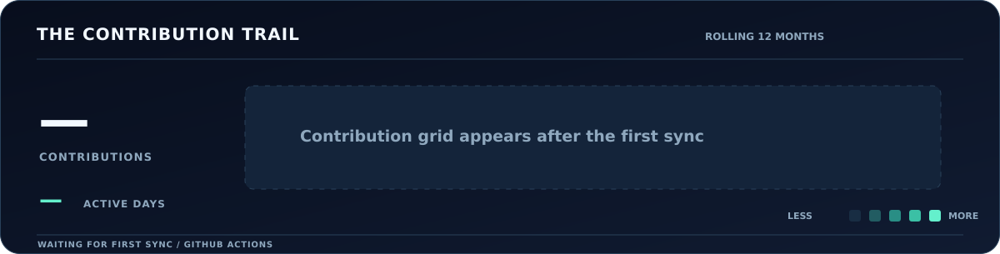

GABSXK / ENGINEERING × CODE / PROFILE 001

  

<picture>
  <source media="(prefers-color-scheme: dark)" srcset="./assets/hero-dark.svg" />
  <source media="(prefers-color-scheme: light)" srcset="./assets/hero-light.svg" />
  
</picture>

 

**Powerplant Engineer × Developer**  
*I turn complex engineering problems into clear, useful software.*

<a href="https://github.com/Gabsxk?tab=repositories">Explore the code</a> &nbsp;·&nbsp;
<a href="https://www.linkedin.com/in/souzagabrielg/">Connect on LinkedIn</a> &nbsp;·&nbsp;
<a href="https://github.com/Gabsxk?tab=overview">View activity</a>

---

### 01 / THE PERSON BEHIND THE CODE

<table>
  <tr>
    <td width="62%" valign="top">
      <h3>Engineering mindset. Developer curiosity.</h3>
      
My work sits at the intersection of <b>aviation engineering, automation, and data</b>. I enjoy turning complicated workflows into tools that make decisions clearer and everyday work simpler.

      
For me, good software doesn't just run. It solves the right problem.

    </td>
    <td width="38%" valign="top">
      WHAT I'M DRAWN TO
      
↗ &nbsp; Intelligent automation

      
↗ &nbsp; Engineering analytics

      
↗ &nbsp; Interfaces that make sense

      
↗ &nbsp; Continuous improvement

    </td>
  </tr>
</table>

### 02 / WHAT I LIKE TO BUILD

<table>
  <tr>
    <td width="33%" valign="top">
      01 — AUTOMATE
      <h3>Less repetition.</h3>
      
Scripts and workflows that replace manual effort with reliable processes.

    </td>
    <td width="34%" valign="top">
      02 — UNDERSTAND
      <h3>More clarity.</h3>
      
Dashboards and models that turn scattered data into useful insight.

    </td>
    <td width="33%" valign="top">
      03 — DELIVER
      <h3>Better tools.</h3>
      
Practical web experiences built around the people who use them.

    </td>
  </tr>
</table>

### 03 / THE TOOLBOX

**Languages & web**  
<code>JavaScript</code> &nbsp; <code>HTML</code> &nbsp; <code>CSS</code> &nbsp; <code>Node.js</code>

**Automation & data**  
<code>Google Apps Script</code> &nbsp; <code>Google Sheets</code> &nbsp; <code>Data visualization</code>

**Workflow**  
<code>Git</code> &nbsp; <code>GitHub</code> &nbsp; <code>GitHub Actions</code>

> The stack is a means to an end. I care more about what a tool makes possible than how fashionable it is.

### 04 / WORK IN PROGRESS

<table>
  <tr>
    <td width="50%" valign="top">
      <h3>Real-world engineering tools</h3>
      
Exploring automation, scenario analysis, and visual decision support for technical workflows.

      ENGINEERING · DATA · AUTOMATION
    </td>
    <td width="50%" valign="top">
      <h3>Public experiments</h3>
      
This space is growing. Follow the repositories to see what becomes public next.

      
<a href="https://github.com/Gabsxk?tab=repositories"><b>Browse repositories ↗</b></a>

    </td>
  </tr>
</table>

### 05 / THE GITHUB SIGNAL

FIRST-PARTY DATA · CUSTOM SVGs · UPDATED BY GITHUB ACTIONS

<picture>
  <source media="(prefers-color-scheme: dark)" srcset="./assets/stats-dark.svg" />
  <source media="(prefers-color-scheme: light)" srcset="./assets/stats-light.svg" />
  
</picture>

 

<picture>
  <source media="(prefers-color-scheme: dark)" srcset="./assets/activity-dark.svg" />
  <source media="(prefers-color-scheme: light)" srcset="./assets/activity-light.svg" />
  
</picture>

Metrics refresh once a day; they are snapshots, not real-time counters.

---

LET'S MAKE SOMETHING USEFUL

### Good engineering is a team sport.

I enjoy working with people who value curiosity, craft, and thoughtful execution.

<a href="https://www.linkedin.com/in/souzagabrielg/"><b>Say hello on LinkedIn</b></a> &nbsp;·&nbsp;
<a href="https://github.com/Gabsxk"><b>Follow on GitHub</b></a>

  

DESIGNED AND MAINTAINED BY GABSXK · NO GITSKINS · NO THIRD-PARTY IMAGE API

